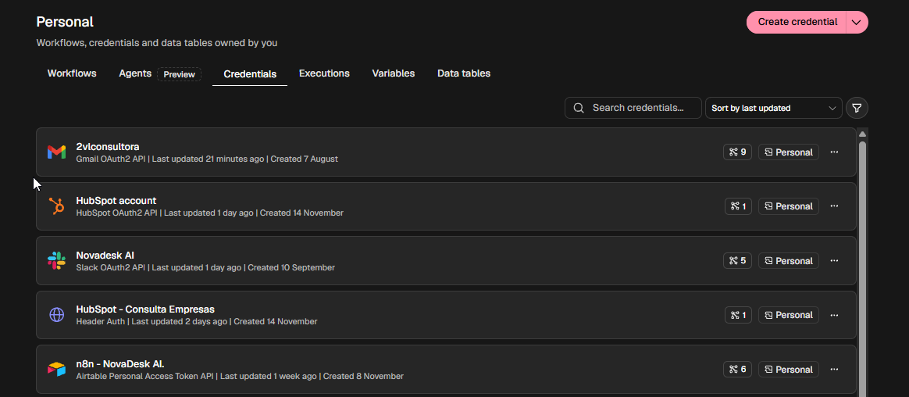

 # NovaDesk AI · Módulo 4

NovaDesk amplía su asistente para NovaERP con dos circuitos en n8n. **Telegram** atiende solicitudes comerciales y delega al worker que integra HubSpot. **Gmail** prepara respuestas de soporte en borradores y avisa al equipo por Slack para que una persona las revise y decida si las envía.

## Integraciones y credenciales

| Servicio | Recorrido | Función |
| --- | --- | --- |
| HubSpot | Telegram | Consultar contactos en el worker comercial. El lienzo también muestra una ruta de búsqueda alternativa y alta mediante upsert. |
| Gmail | Correo | Recibir consultas y crear borradores. |
| Slack | Correo | Avisar al equipo cuando hay un borrador pendiente de revisión. |
| Airtable | Ambos | Consultar datos de clientes y empresas. El Manager de Telegram también usa Airtable para el contexto. |
| DeepSeek | Ambos | Modelo del Manager en Telegram y del agente de respuestas en Gmail. |

La sección **Credentials** de n8n muestra credenciales OAuth2 configuradas para HubSpot, Gmail y Slack. También aparecen una credencial Header Auth para una consulta de HubSpot y un token de Airtable. La captura muestra los tipos de credencial; su alcance y estado de conexión se comprueban en n8n.

## Telegram y HubSpot · Cotización comercial

1. El Manager recibe el mensaje de Telegram, valida el contacto y la empresa en Airtable, recupera contexto y puede delegar la solicitud al **Worker comercial**.
2. La ejecución aportada muestra la llamada al worker. En el worker, el recorrido resaltado encuentra un `HubSpot_Contacto_ID` y llega a **Buscar contacto Hubspot**.
3. El lienzo muestra una ruta alternativa para cuando falta el ID. Pasa por **Buscar contacto API** y un Switch antes de vincular un contacto existente o pasar a **Crear contacto Hubspot**, configurado como upsert.
4. En Telegram, el bot informó que generó una cotización en estado **Borrador** y reportó la sincronización con HubSpot. La captura de HubSpot muestra una oportunidad NovaDesk con la referencia de esa cotización. La prueba de alta de un contacto nuevo sigue pendiente.

[Ejecución de Telegram en n8n](evidencias/02-ejecucion-telegram.png) · [Consulta al contacto en el worker comercial](evidencias/03-worker-hubspot.png)

## Gmail y Slack · Borrador de soporte

1. `Gmail Trigger NovaDesk` está configurado para consultar Gmail cada minuto. El IF inmediato evalúa patrones de correo automático.
2. El flujo extrae remitente, asunto, cuerpo e identificadores del mensaje e hilo. Acota el cuerpo a 2.000 caracteres y enmascara secuencias de 12 a 22 dígitos.
3. El agente de Gmail usa DeepSeek y un Structured Output Parser para clasificar la consulta y proponer una respuesta. Airtable busca el contacto por correo y valida que el contacto y su empresa estén activos.
4. El flujo comprueba que haya destinatario, asunto y cuerpo preparados, y que `requiere_revision` sea verdadero. Gmail crea el borrador y el siguiente nodo avisa por Slack con remitente, asunto y estado.
5. En la prueba de consulta de stock, la captura de n8n muestra el recorrido hasta Slack. La nueva captura de Gmail muestra el borrador abierto dentro del hilo original, con el campo **Para** completado. La captura de Slack muestra el aviso de revisión pendiente. El export que se revisó corresponde a la configuración anterior a esta corrección.

[Ejecución de Gmail hasta Slack](evidencias/04-ejecucion-gmail.png)

## Archivos y reproducción

- Export del Manager previsto en `workflows/checkpoint4_alexis_varela.json`. La rama Gmail se revisó en la copia `prueba entrega 4`, ID `3ayBK6F1ZD8LhOlA`.
- Export del Worker comercial pendiente de incorporar. Su recorrido se documentó con capturas.
- Para reproducir las pruebas, importá los exports limpios, vinculá el Worker comercial al Manager, reasigná las credenciales y seleccioná la base de Airtable y el canal de prueba en Slack. Usá un contacto de prueba vinculado a una empresa activa.
- El [checklist de evidencias](evidencias/checklist.md) indica qué criterios cubren las capturas y qué falta para cerrar la entrega.

- Export del Manager previsto en `workflows/checkpoint4_alexis_varela.json`. La rama Gmail se revisó en la copia `prueba entrega 4`, ID `3ayBK6F1ZD8LhOlA`.
- Export del Worker comercial pendiente de incorporar. Su recorrido se documentó con capturas.
- Para reproducir las pruebas, importá los exports limpios, vinculá el Worker comercial al Manager, reasigná las credenciales y seleccioná la base de Airtable y el canal de prueba en Slack. Usá un contacto de prueba vinculado a una empresa activa.
- El [checklist de evidencias](evidencias/checklist.md) indica qué criterios cubren las capturas y qué falta para cerrar la entrega.
